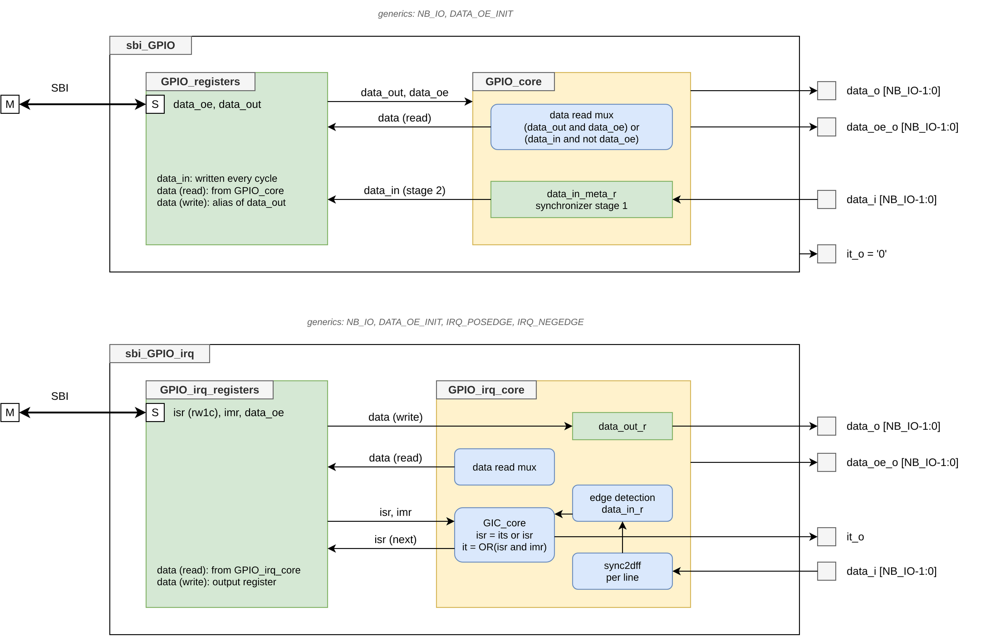
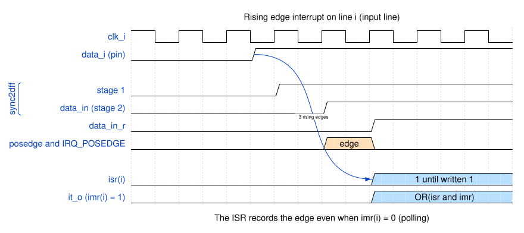

<!--
  README MODEL (common to every Asylum IP, keep the same headings)
  ----------------------------------------------------------------
  Regenerate from the sources, never from the previous README text alone:
    hdl/*.vhd (entities, generics, ports), hdl/csr/*.hjson (register map),
    <IP>.core (VLNV, targets, depends), mk/targets.txt, sim/, syn/, esw/.
  Sections, in this order:
    badges / title + one-line pitch / Overview / Features / Block Diagram /
    Getting Started / Hardware Interfaces / Configuration / Resources /
    Theory of Operation / Registers / Programmer's Guide /
    Design Verification / Dependencies and Related IPs / License
  Rules:
    - English, short and factual: every statement backed by the sources.
    - No VLNV line: the version badge shows it.
    - Badges: first line version, license; second line CI, lint, sim, syn.
    - Block diagram and FSM: pages Overview and FSM of doc/<NAME>.drawio, exported to
      doc/<NAME>-Overview.png and doc/<NAME>-FSM.png (make -C doc).
    - Timing diagrams: WaveDrom source doc/<NAME>-<what>.json, rendered
      doc/<NAME>-<what>.svg (make -C doc), shown as images.
    - No CPU named (OpenBlaze, PicoBlaze, RISC-V) outside the CPU and SoC IPs.
    - Registers: link to the generated hdl/csr/<X>_csr.md, never copy the tables.
    - Tables: Configuration = Name|Type|Default|Description,
      Hardware Interfaces = Name|Direction|Type|Description, grouped by interface.
    - A section with nothing to say is one line ("This IP has no
      software-visible registers."), never removed.
-->
[](https://github.com/deuskane/asylum-component-gpio/tags)
[](LICENSE)

[](https://github.com/deuskane/asylum-component-gpio/actions/workflows/ci.yml)
[](https://github.com/deuskane/asylum-component-gpio/actions/workflows/ci.yml)
[](https://github.com/deuskane/asylum-component-gpio/actions/workflows/ci.yml)
[](https://github.com/deuskane/asylum-component-gpio/actions/workflows/ci.yml)

# GPIO

**A small, readable GPIO in VHDL: 1 to 8 lines with a direction per line, input synchronizer, optional edge interrupts, four 8-bit registers.**

Part of the [Asylum project](https://github.com/deuskane/asylum-project), a collection of small IP cores, written to be read and learned from.

## Table of Contents

1. [Overview](#overview)
2. [Features](#features)
3. [Block Diagram](#block-diagram)
4. [Getting Started](#getting-started)
5. [Hardware Interfaces](#hardware-interfaces)
6. [Configuration](#configuration)
7. [Resources](#resources)
8. [Theory of Operation](#theory-of-operation)
9. [Registers](#registers)
10. [Programmer's Guide](#programmers-guide)
11. [Design Verification](#design-verification)
12. [Dependencies and Related IPs](#dependencies-and-related-ips)
13. [License](#license)

## Overview

This IP gives software up to 8 general purpose lines: LEDs, switches, buttons, chip selects, anything driven or read one bit at a time. Each line is an output or an input, chosen by software. Software drives the IP through four 8-bit registers on the SBI bus (the simple bus of Asylum).

Two variants share the same ports:

- **`sbi_GPIO`**: registers `data`, `data_oe` (direction), `data_in` (pins) and `data_out` (output register); no interrupt (`it_o` is `'0'`).
- **`sbi_GPIO_irq`**: registers `isr`, `imr`, `data`, `data_oe`; an interrupt on the rising and / or falling edge of each line, selected by generics.

The pads are not in the IP: `data_o`, `data_oe_o` and `data_i` go to tri-state IO buffers at the top level of the chip or the FPGA.

## Features

- 1 to 8 lines (`NB_IO`), direction per line, reset value of the direction set by a generic (`DATA_OE_INIT`)
- Reading `data` returns the output register on the output lines and the pin on the input lines
- Asynchronous inputs synchronized by 2 flip-flops per line
- `sbi_GPIO`: `data_in` (pins) and `data_out` (output register) for read-modify-write without touching the input lines
- `sbi_GPIO_irq`: interrupt per line on the rising edge (`IRQ_POSEDGE`) and / or the falling edge (`IRQ_NEGEDGE`), interrupt status register (write 1 to clear) and mask register, no interrupt on a line configured as output
- Zero wait state bus accesses

## Block Diagram



## Getting Started

The cores of the Asylum IPs are published in the FuseSoC library [asylum-cores](https://github.com/deuskane/asylum-cores) (with the UVVM core used by the testbenches):

```bash
pip install fusesoc
fusesoc library add https://github.com/deuskane/asylum-cores
fusesoc run --target sim_gpio_irq_posedge asylum:component:GPIO  # needs GHDL
```

To use the IP in your design, add `asylum:component:GPIO` to the `depend` list of your core and instantiate `sbi_GPIO` or `sbi_GPIO_irq` (library `asylum`):

```vhdl
library asylum;
use     asylum.sbi_pkg.all;
use     asylum.gpio_pkg.all;

  ins_gpio : sbi_GPIO_irq
    generic map
    ( NAME         => "GPIO0"
     ,NB_IO        => 8
     ,DATA_OE_INIT => x"0F"          -- lines 3..0 output after reset
     ,IRQ_POSEDGE  => x"F0"          -- interrupt on the rising edge of lines 7..4
     ,IRQ_NEGEDGE  => x"00"
    )
    port map
    ( clk_i     => clk
     ,cke_i     => '1'
     ,arstn_i   => arst_b
     ,sbi_ini_i => sbi_ini           -- 2 address bits, 8-bit data
     ,sbi_tgt_o => sbi_tgt
     ,data_i    => gpio_i
     ,data_o    => gpio_o
     ,data_oe_o => gpio_oe
     ,it_o      => gpio_it
    );
```

[PicoSoC](https://github.com/deuskane/asylum-soc-picosoc) is a complete example: it connects `sbi_GPIO_irq` instances to the switches and the LEDs of a board.

## Hardware Interfaces

Top-level entities: **`sbi_GPIO`** ([hdl/sbi_GPIO.vhd](hdl/sbi_GPIO.vhd)) and **`sbi_GPIO_irq`** ([hdl/sbi_GPIO_irq.vhd](hdl/sbi_GPIO_irq.vhd)), same ports, components in `asylum.gpio_pkg`.

### Clock and Reset

| Name | Direction | Type | Description |
|------|-----------|------|-------------|
| `clk_i` | in | std_logic | System clock, the only clock of the IP |
| `cke_i` | in | std_logic | Clock enable, not used (tie to `'1'`) |
| `arstn_i` | in | std_logic | Asynchronous reset, active low |

### Bus (SBI)

| Name | Direction | Type | Description |
|------|-----------|------|-------------|
| `sbi_ini_i` | in | sbi_ini_t | Request from the initiator (`cs`, `re`, `we`, `addr`, `wdata`); 2 address bits, 8-bit data |
| `sbi_tgt_o` | out | sbi_tgt_t | Response to the initiator (`ready`, always `'1'`, `rdata`, `info`) |

### GPIO

| Name | Direction | Type | Description |
|------|-----------|------|-------------|
| `data_i` | in | std_logic_vector(NB_IO-1 downto 0) | Pins, asynchronous (synchronized in the IP) |
| `data_o` | out | std_logic_vector(NB_IO-1 downto 0) | Output register |
| `data_oe_o` | out | std_logic_vector(NB_IO-1 downto 0) | Output enable per line, 1 = output (`data_oe` register) |

### Interrupt

| Name | Direction | Type | Description |
|------|-----------|------|-------------|
| `it_o` | out | std_logic | `sbi_GPIO_irq`: OR of the `isr` bits not masked by `imr`, active high, level; `sbi_GPIO`: always `'0'` |

<details>
<summary><b>GPIO_core / GPIO_irq_core</b>: the GPIO logic behind the registers</summary>

[hdl/GPIO_core.vhd](hdl/GPIO_core.vhd) and [hdl/GPIO_irq_core.vhd](hdl/GPIO_irq_core.vhd), components in `asylum.gpio_pkg`. Same `clk_i`, `cke_i`, `arstn_i`, `data_i`, `data_o`, `data_oe_o` as the top level, and the record ports of the register bank generated by regtool:

| Name | Direction | Type | Description |
|------|-----------|------|-------------|
| `sw2hw_i` | in | GPIO_sw2hw_t / GPIO_irq_sw2hw_t | Register values (`asylum.GPIO_csr_pkg` / `asylum.GPIO_irq_csr_pkg`) |
| `hw2sw_o` | out | GPIO_hw2sw_t / GPIO_irq_hw2sw_t | Read value of `data`; `data_in` (`GPIO_core`) or next `isr` (`GPIO_irq_core`) |
| `it_o` | out | std_logic | `GPIO_irq_core` only |

Generics: `NB_IO`, and `IRQ_POSEDGE` / `IRQ_NEGEDGE` for `GPIO_irq_core` (see [Configuration](#configuration)).

</details>

## Configuration

| Name | Type | Default | Description |
|------|------|---------|-------------|
| `NAME` | string | `""` | Instance name, visible in `sbi_tgt_o.info` |
| `NB_IO` | natural | `8` | Number of lines, 1 to 8 (the registers are 8 bits wide) |
| `DATA_OE_INIT` | std_logic_vector(7 downto 0) | *(none)* | Reset value of `data_oe`: bit i = 1, line i is an output after reset |
| `IRQ_POSEDGE` | std_logic_vector(7 downto 0) | *(none)* | `sbi_GPIO_irq` only: bit i = 1, interrupt on the rising edge of line i |
| `IRQ_NEGEDGE` | std_logic_vector(7 downto 0) | *(none)* | `sbi_GPIO_irq` only: bit i = 1, interrupt on the falling edge of line i |

The vector generics are 8 bits wide whatever `NB_IO`: they set 8-bit register fields.

## Resources

Figures of the `syn_*` targets (`make nonreg_syn`, see [Targets](#targets)): [syn/sbi_GPIO_wrapper.vhd](syn/sbi_GPIO_wrapper.vhd) with the generics of each configuration, synthesized by Yosys and its GHDL plugin; the reports are in the build directory of each target. The wrapper holds **one `sbi_GPIO` and one `sbi_GPIO_irq`** with the same `NB_IO` and `DATA_OE_INIT`: each figure is the sum of the two variants.

| Configuration | LUT¹ | LUTRAM¹ | FF¹ | CARRY4¹ | MUXF7/F8¹ | BRAM¹ | DSP¹ | Area² (µm²) | kGE³ |
|---|---|---|---|---|---|---|---|---|---|
| `syn_default` (8 lines, interrupt on both edges of every line) | 103 | 0 | 88 | 0 | 0 | 0 | 0 | 3210.58 | 0.855 |
| `syn_led` (8 lines output after reset, no interrupt) | 102 | 0 | 80 | 0 | 0 | 0 | 0 | 2960.34 | 0.789 |
| `syn_nb_io4` (4 lines, edges 0x0A / 0x0C) | 91 | 0 | 63 | 0 | 0 | 0 | 0 | 2448.60 | 0.652 |

¹ Xilinx Artix-7 (LUT6), Yosys 0.33 `synth_xilinx -flatten -noiopad -noclkbuf`, before place and route: every cell of the netlist is counted, Vivado may differ. An `INV` counts as a `LUT1`: `synth_xilinx` puts one on the reset pin of each flip-flop with the active-low reset (56 of the 103 LUTs of `syn_default`). The IP has no memory: no LUTRAM, no BRAM. `syn_default` has 88 flip-flops: 32 in `sbi_GPIO` (`data_oe`, `data_out`, `data_in`, first synchronizer stage) and 56 in `sbi_GPIO_irq` (`isr`, `imr`, `data_oe`, output register, 2 synchronizer stages, `data_in_r`).

² SkyWater sky130 `sky130_fd_sc_hd`, typical corner (tt, 25 °C, 1.80 V), Yosys 0.33 `synth` + `dfflibmap` + `abc -liberty`: standard-cell area only, no timing constraint, no buffering, clock tree or placement.

³ Area in thousands of NAND2 gate equivalents (`sky130_fd_sc_hd__nand2_1` = 3.7536 µm²).

## Theory of Operation

### Hierarchy

| File | Unit | Role |
|------|------|------|
| [hdl/sbi_GPIO.vhd](hdl/sbi_GPIO.vhd) | `sbi_GPIO` | Top level: `GPIO_registers` + `GPIO_core` |
| [hdl/GPIO_core.vhd](hdl/GPIO_core.vhd) | `GPIO_core` | Pins, read value of `data`, first stage of the input synchronizer |
| [hdl/sbi_GPIO_irq.vhd](hdl/sbi_GPIO_irq.vhd) | `sbi_GPIO_irq` | Top level: `GPIO_irq_registers` + `GPIO_irq_core` |
| [hdl/GPIO_irq_core.vhd](hdl/GPIO_irq_core.vhd) | `GPIO_irq_core` | Output register, input synchronizer (`sync2dff`), edge detection, `GIC_core` |
| [hdl/gpio_pkg.vhd](hdl/gpio_pkg.vhd) | `gpio_pkg` | Components |
| `hdl/csr/GPIO_csr.vhd`, `hdl/csr/GPIO_irq_csr.vhd` | `GPIO_registers`, `GPIO_irq_registers` | Register banks, generated by regtool from [hdl/csr/GPIO.hjson](hdl/csr/GPIO.hjson) and [hdl/csr/GPIO_irq.hjson](hdl/csr/GPIO_irq.hjson) |
| [hdl/legacy/GPIO_v1.vhd](hdl/legacy/GPIO_v1.vhd) | `GPIO_v1` | First version of the IP, with a direct `cs`/`re`/`we` bus: simulation only, reference model of `tb_GPIO` |

### Data path

- `data_o` is the output register and `data_oe_o` the `data_oe` register: a line drives its pad only when its `data_oe` bit is 1, `data_o` keeps the output register of an input line.
- Reading `data` returns, bit per bit, `(output register and data_oe) or (pin and not data_oe)`: the value driven on an output line, the pin of an input line.
- Writing `data` loads the output register of **every** line, input lines included: write the value of a line before turning it into an output (`data`, then `data_oe`), it appears on the pad without a glitch.
- `sbi_GPIO` also has `data_in` (the pins, whatever the direction) and `data_out` (the output register, readable); a write of `data` or `data_out` loads the same register.
- The register bits above `NB_IO` have no pin: write them 0.

### Input synchronizer

`data_i` is asynchronous: each line goes through 2 flip-flops before any use, so a pin change is seen by a read 2 clock cycles later.

- `sbi_GPIO`: `data_in_meta_r` in `GPIO_core`, then the `data_in` register, written every cycle.
- `sbi_GPIO_irq`: one `sync2dff` of `asylum:target:techmap` per line (synthesis attributes keep its two flip-flops together; declare the path to the first one as a false path).

### Edge interrupts (`sbi_GPIO_irq`)



- `data_in_r` keeps the synchronized pins of the previous cycle: `posedge = data_in and not data_in_r`, `negedge = not data_in and data_in_r`.
- An edge is an event of line i when bit i of `IRQ_POSEDGE` (rising) or `IRQ_NEGEDGE` (falling) is set **and** the line is an input: the pin of an output line is the loopback of the driven value, a software write is not an event.
- `GIC_core` of `asylum:system:GIC` sets the `isr` bit of each event (`isr = events or isr`), masked or not: software can poll `isr`. `it_o` is the OR of `isr and imr`: `imr` only masks the interrupt output.
- `it_o` rises 3 clock edges after the edge of the pin (2 for the synchronizer, 1 for `isr`); it stays high until software writes 1 to the `isr` bits or masks them.
- `data_in_r` and the synchronizer have no reset: a pin high during the reset is not an edge at the reset release.

## Registers

Four 8-bit registers (2 address bits) per variant:

| Address | `sbi_GPIO` | `sbi_GPIO_irq` |
|---------|------------|----------------|
| 0x0 | `data` | `isr` (write 1 to clear) |
| 0x1 | `data_oe` | `imr` |
| 0x2 | `data_in` (read only) | `data` |
| 0x3 | `data_out` | `data_oe` |

- Register documentation: **[hdl/csr/GPIO_csr.md](hdl/csr/GPIO_csr.md)** (`sbi_GPIO`), **[hdl/csr/GPIO_irq_csr.md](hdl/csr/GPIO_irq_csr.md)** (`sbi_GPIO_irq`)
- C headers: [hdl/csr/GPIO_csr.h](hdl/csr/GPIO_csr.h), [hdl/csr/GPIO_irq_csr.h](hdl/csr/GPIO_irq_csr.h)
- Sources: [hdl/csr/GPIO.hjson](hdl/csr/GPIO.hjson), [hdl/csr/GPIO_irq.hjson](hdl/csr/GPIO_irq.hjson) (regtool)

## Programmer's Guide

### Initialization

1. Write the output value of the future output lines (`data_out` or `data`).
2. Write `data_oe` (1 = output).
3. `sbi_GPIO_irq`: write 0xFF to `isr` to drop the edges seen before, then unmask the lines in `imr`.

### Read-modify-write

A read of `data` returns the pins of the input lines, a write of `data` loads them into the output register: a read-modify-write of `data` copies the pins of the input lines into their output register, which shows up when such a line becomes an output. With `sbi_GPIO`, do the read-modify-write on `data_out`; with `sbi_GPIO_irq`, keep a copy of the output value in software.

### Interrupt

`it_o` is a level: the handler reads `isr` (and `imr`), handles the pending lines and writes 1 to their `isr` bits. An edge that arrives while its line is masked stays in `isr`: clear it before unmasking the line if it must be ignored.

### Example

The registers are 8 bits wide, at consecutive byte addresses from the base address of the IP (`0x40001000` and `0x40002000` are examples, use the address map of your SoC).

```c
#include <stdint.h>
#include "GPIO_csr.h"
#include "GPIO_irq_csr.h"

#define GPIO_BASE     ((uintptr_t)0x40001000u)   // example base addresses
#define GPIO_IRQ_BASE ((uintptr_t)0x40002000u)

static inline void reg_wr(uintptr_t base, uint32_t offset, uint8_t data)
{
  *(volatile uint8_t *)(base + offset) = data;
}

static inline uint8_t reg_rd(uintptr_t base, uint32_t offset)
{
  return *(volatile uint8_t *)(base + offset);
}

// sbi_GPIO: LEDs on lines 0..3, switches on lines 4..7
void gpio_init(void)
{
  reg_wr(GPIO_BASE, GPIO_DATA_OUT, 0x00);      // output value first,
  reg_wr(GPIO_BASE, GPIO_DATA_OE , 0x0F);      // then the direction
}

void led_toggle(unsigned line)
{
  // read-modify-write on data_out (data would copy the pins of the input lines)
  reg_wr(GPIO_BASE, GPIO_DATA_OUT, reg_rd(GPIO_BASE, GPIO_DATA_OUT) ^ (uint8_t)(1u << line));
}

uint8_t switches(void)
{
  return reg_rd(GPIO_BASE, GPIO_DATA_IN) >> 4;
}

// sbi_GPIO_irq: buttons on lines 0..3, edges selected by IRQ_POSEDGE / IRQ_NEGEDGE
void buttons_init(void)
{
  reg_wr(GPIO_IRQ_BASE, GPIO_IRQ_DATA_OE, 0x00);   // every line input
  reg_wr(GPIO_IRQ_BASE, GPIO_IRQ_ISR    , 0xFF);   // drop the edges seen before
  reg_wr(GPIO_IRQ_BASE, GPIO_IRQ_IMR    , 0x0F);   // it_o on lines 0..3
}

uint8_t buttons_irq_handler(void)
{
  uint8_t pending = reg_rd(GPIO_IRQ_BASE, GPIO_IRQ_ISR) & reg_rd(GPIO_IRQ_BASE, GPIO_IRQ_IMR);
  reg_wr(GPIO_IRQ_BASE, GPIO_IRQ_ISR, pending);    // write 1 clears
  return pending;
}
```

## Design Verification

### Testbenches

| File | DUT | Description |
|------|-----|-------------|
| [sim/gpio/tb_GPIO.vhd](sim/gpio/tb_GPIO.vhd) | `sbi_GPIO` | Self-checking UVVM testbench with the SBI BFM, 8 lines, generics `TESTS_LIST` (scenarios, see below) and `DATA_OE_INIT`. The legacy `GPIO_v1` runs next to the DUT on the same bus and pins (its input delayed by one cycle: it has a single input register): a monitor compares `rdata`, `ready`, `data_o` and `data_oe_o` of the two on every rising edge of the clock, in every scenario (these comparisons are not counted as checks). Scenarios in `tb_GPIO_<name>_pkg`, names and dispatch in [tb_GPIO_tests_pkg](sim/gpio/tb_GPIO_tests_pkg.vhd) |
| [sim/gpio_irq/tb_GPIO_irq.vhd](sim/gpio_irq/tb_GPIO_irq.vhd) | `sbi_GPIO_irq` | Self-checking UVVM testbench with the SBI BFM, generics `TESTS_LIST`, `NB_IO`, `DATA_OE_INIT`, `IRQ_POSEDGE`, `IRQ_NEGEDGE`: the expected values are computed from the generics. Scenarios in `tb_GPIO_irq_<name>_pkg`, names, applicability and dispatch in [tb_GPIO_irq_tests_pkg](sim/gpio_irq/tb_GPIO_irq_tests_pkg.vhd) |

The helpers of both testbenches (register accesses, pin drive and checks, it_o latency, reset pulse) are in [sim/common/tb_GPIO_bfm_pkg.vhd](sim/common/tb_GPIO_bfm_pkg.vhd).

### Scenarios (`TESTS_LIST`)

The scenarios are chosen at run time with the generic `TESTS_LIST`: names separated by `,` without space (`posedge,mask,posedge`), a name may be repeated. The sequencer first checks every name (an unknown name, or a scenario that does not apply to the generics, is a `TB_ERROR` before any scenario runs), then for each scenario drives a reset pulse with the bus inactive and the pins at 0, logs `TEST <i>/<N> : <name>` and runs it: each scenario starts from reset and configures the DUT itself. The empty list (default) only compiles and elaborates the testbench. The list is parsed and its names checked with `list_length` / `list_item` / `list_contains` of `asylum.string_pkg` (`asylum:utils:pkg` >= 1.10.0).

`tb_GPIO` (checks counted as the `=> OK` lines of the log, `DATA_OE_INIT = 0`):

| Name | Checks | Description |
|------|--------|-------------|
| `reset_values` | 10 | Reset values of the registers and pins (`data_oe` = `DATA_OE_INIT`), `it_o = 0`; `data_in` and `data` read the pins after the synchronizer |
| `output` | 13 | Every line output: writes of `data` and `data_out` drive `data_o`, `data` and `data_out` read the output register, `data_in` the pins; a write of `data_in` has no effect |
| `input` | 8 | Every line input: `data` and `data_in` read the pins, `data_oe_o = 0`, `data_o` keeps the output register |
| `mixed` | 6 | Inputs and outputs on the same port: `data` per bit, two direction patterns |
| `async_reset` | 5 | Reset asserted between two clock edges: `data_o` and `data_oe_o` reset at once; the pins held high during the reset are read after it |
| `walking_one` | 32 | Walking one on the output register (lines output), then on the pins (lines input): the stimulus of the former `tb_GPIO_vs_v1` |

`tb_GPIO_irq` (reference configuration: 4 lines, `IRQ_POSEDGE = 0x0A`, `IRQ_NEGEDGE = 0x0C`: line 0 no interrupt, line 1 rising edge, line 2 falling edge, line 3 both; `DATA_OE_INIT = 0x06`: lines 1 and 2 output after reset):

| Name | Checks | Description |
|------|--------|-------------|
| `reset_values` | 8 | Reset values of `isr`, `imr`, `data_oe` (`DATA_OE_INIT`) and of the pins, `it_o = 0`; `data` reads the pins of the input lines |
| `output` | 9 | A write of `data` loads the output register of input lines too, driven once the lines are outputs; `data` reads the output register of the output lines |
| `input` | 6 | `data` reads the pins of the input lines, the output register of the output lines, per bit |
| `posedge` | 7 | Rising edge on every line: `isr` = the lines of `IRQ_POSEDGE`, `it_o` 3 cycles after the pin; `isr` write 0 has no effect, write 1 clears that bit only |
| `negedge` | 6 | Falling edge on every line: `isr` = the lines of `IRQ_NEGEDGE`, `it_o` latency |
| `mask` | 8 | `imr` only masks `it_o`: the edge of a masked line is in `isr`, unmasking it raises `it_o`, masking it again drops `it_o` and keeps `isr` (needs a line of `IRQ_POSEDGE`) |
| `output_line` | 7 | No interrupt on a line configured as output, nor when it becomes an input with its pin high; an interrupt again on an edge of the input line (needs a line of `IRQ_POSEDGE`; the lowest line with both edges if any) |
| `async_reset` | 5 | Reset asserted between two clock edges with the pins high: `data_o`, `data_oe_o`, `it_o` reset at once; the pins high during the reset give no edge at the release |

### Targets

| Target | Toplevel | Description |
|--------|----------|-------------|
| `default` | `sbi_GPIO` | HDL fileset + generation of both register banks (not a simulation) |
| `sim_gpio` | `tb_GPIO` | Reference configuration of `tb_GPIO` (`DATA_OE_INIT = 0`): build and elaboration only (`TESTS_LIST` empty), base of the scenario targets and of the list runs |
| `sim_gpio_<name>` | `tb_GPIO` | One target per scenario: `sim_gpio_reset_values`, `_output`, `_input`, `_mixed`, `_async_reset`, `_walking_one` (74 checks in all) |
| `sim_gpio_led` | `tb_GPIO` | `DATA_OE_INIT = 0xFF`, every scenario (74 checks) |
| `sim_gpio_irq` | `tb_GPIO_irq` | Reference configuration of `tb_GPIO_irq` (4 lines, edges 0x0A / 0x0C, `DATA_OE_INIT = 0x06`): build and elaboration only |
| `sim_gpio_irq_<name>` | `tb_GPIO_irq` | One target per scenario: `sim_gpio_irq_reset_values`, `_output`, `_input`, `_posedge`, `_negedge`, `_mask`, `_output_line`, `_async_reset` (56 checks in all) |
| `sim_gpio_irq_default` | `tb_GPIO_irq` | 8 lines, interrupt on both edges of every line, every scenario (56 checks) |
| `sim_gpio_irq_led` | `tb_GPIO_irq` | 8 lines output after reset, no interrupt: `reset_values`, `output`, `input`, `posedge`, `negedge`, `async_reset` (41 checks) |
| `lint_ghdl` | `asylum.sbi_GPIO_wrapper` | GHDL `-Wall` analysis and elaboration of [syn/sbi_GPIO_wrapper.vhd](syn/sbi_GPIO_wrapper.vhd) (`sbi_GPIO` and `sbi_GPIO_irq` with flat SBI ports) |
| `lint_ghdl_synth_<config>` | `asylum.sbi_GPIO_wrapper` | `ghdl --synth` check (no latch, synthesizable) for 3 generic configurations: `default`, `led`, `nb_io4` |
| `syn_<config>` | `asylum.sbi_GPIO_wrapper` | Synthesis with Yosys, Artix-7 and sky130 (see [Resources](#resources)), same 3 configurations: `syn_default`, `syn_led`, `syn_nb_io4` |

The reference configuration of a testbench has a build-only base target and one target per scenario: one CI job per scenario, a failure is isolated. Every other configuration has one target that runs its whole list: the `TEST <i>/<N>` header names a failing scenario. FuseSoC replaces the `parameters` list of an inherited target, so each target repeats the generics of its configuration.

Every `sim_*`, `lint_*` and `syn_*` target is a job of the [GitHub CI](https://github.com/deuskane/asylum-component-gpio/actions/workflows/ci.yml), run in the [asylum-env](https://github.com/deuskane/asylum-ci) image (GHDL, FuseSoC, UVVM, Yosys). The `sim`, `lint` and `syn` badges count the passed and failed targets of the last run on `main`.

### How to Run

From a clone of [asylum-project](https://github.com/deuskane/asylum-project) (GHDL and FuseSoC installed, or in the asylum-env image):

```bash
make help                        # variables, rules and targets
make sim_gpio_irq_posedge        # one scenario, log in log/
make sim_gpio_irq_default        # every scenario of a configuration
make nonreg_sim                  # every sim_* target
make nonreg_lint                 # every lint_* target
make nonreg_syn                  # every syn_* target (Yosys, figures of Resources)
make TARGETS_FILTER=^sim_gpio_irq nonreg_sim
```

To run a list of scenarios, build the testbench once, then run the list without recompiling, either with FuseSoC (same `--build-root` and `--no-export` as the Makefile, so that the build of the target is reused; any generic of the target can be overridden after the VLNV):

```bash
make sim_gpio_irq                # build and elaboration (TESTS_LIST empty)
fusesoc --cores-root . run --build-root build --no-export --run --target sim_gpio_irq asylum:component:GPIO:2.1.0 --TESTS_LIST=posedge,mask,posedge
```

or in the build directory of the target. `EXTRA_OPTIONS` replaces every generic set by the target: repeat the generics of the configuration, else their default values apply:

```bash
cd build/asylum_component_GPIO_2.1.0/sim_gpio_irq-ghdl
make run EXTRA_OPTIONS="-gTESTS_LIST=posedge,mask -gNB_IO=4 -gDATA_OE_INIT=00000110 -gIRQ_POSEDGE=00001010 -gIRQ_NEGEDGE=00001100"
```

To add a scenario: a `tb_GPIO_<name>_pkg` (or `tb_GPIO_irq_<name>_pkg`) package with a `run` procedure in the `sim_gpio` (or `sim_gpio_irq`) fileset, its name in `C_TESTS` and its case in `run_test` of the `tests_pkg`, a `sim_gpio_<name>` (or `sim_gpio_irq_<name>`) target and the name in the `TESTS_LIST` of the other configurations in [GPIO.core](GPIO.core), then `make mk/targets.txt` and `make ci_generate`.

Outside the CI, GHDL writes a waveform `dut.fst`.

## Dependencies and Related IPs

| Core | Repository | Purpose |
|------|------------|---------|
| `asylum:system:GIC` (>= 2.0.0) | [asylum-system-gic](https://github.com/deuskane/asylum-system-gic) | `GIC_core`: `isr` update and `it_o` of `sbi_GPIO_irq` |
| `asylum:utils:generators` | [asylum-utils-generators](https://github.com/deuskane/asylum-utils-generators) | regtool (register generator) and the CSR building blocks (`csr_reg`, `csr_ext`) |
| `asylum:utils:pkg` | [asylum-utils-pkg](https://github.com/deuskane/asylum-utils-pkg) | Common packages (`sbi_pkg`, ...); the testbenches need >= 1.10.0 (`string_pkg` lists of `TESTS_LIST`) |
| `asylum:target:techmap` | [asylum-target-techmap](https://github.com/deuskane/asylum-target-techmap) | `sync2dff` synchronizer of `sbi_GPIO_irq` |
| `asylum:utils:ghdl_synth` | [asylum-utils-generators](https://github.com/deuskane/asylum-utils-generators) | `ghdl --synth` check of the `lint_ghdl_synth_*` targets |
| `asylum:utils:yosys_synth` | [asylum-utils-generators](https://github.com/deuskane/asylum-utils-generators) | Yosys synthesis of the `syn_*` targets (Artix-7 and sky130) |
| `bitvis:verification:uvvm` | [UVVM](https://github.com/UVVM/UVVM) | Verification library and SBI BFM |

Used by [asylum-soc-picosoc](https://github.com/deuskane/asylum-soc-picosoc). Interrupt controller of Asylum: [GIC](https://github.com/deuskane/asylum-system-gic). All the IPs: [asylum-project](https://github.com/deuskane/asylum-project).

## License

Apache License 2.0, see [LICENSE](LICENSE).
